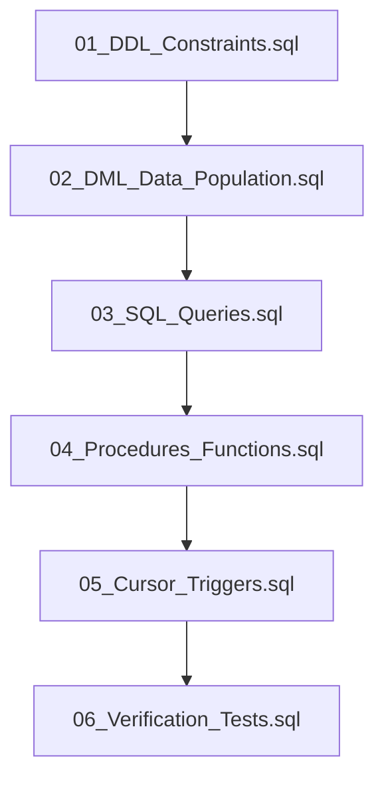

# SecureBank — Review II Database Execution Run Order

**Student Name:** Harsha Vardhan Singh  
**Registration Number:** 24BYB0099  
**Institution:** Vellore Institute of Technology, Vellore  
**Course:** BCSE302L — Database Systems (Review II)  
**Database Name:** `Securebank_db2`

---

## 1. Prerequisites and Database Environment

- **Database Platform:** MySQL 8.0+
- **Database Engine:** InnoDB
- **Database Name:** `Securebank_db2`
- **Default Port:** `3306`

> [!IMPORTANT]
> The database name `Securebank_db2` is strictly used to maintain 100% isolation from previous schemas and ensure that existing work in `securebank_db` is never modified or dropped.

---

## 2. Script Execution Dependency Order

The scripts must be executed in the following sequential order:



| Order | Script File | Purpose | Rubric Category |
|:---:|---|---|:---:|
| **1** | `sql/01_DDL_Constraints.sql` | Creates database `Securebank_db2` and 7 tables with PK, FK, CHECK, and UNIQUE constraints | **Category 1 (2 Marks)** |
| **2** | `sql/02_DML_Data_Population.sql` | Populates demo data across all 7 tables and demonstrates INSERT, UPDATE, DELETE | **Category 2 (1 Mark)** |
| **3** | `sql/03_SQL_Queries.sql` | Executes 14 analytical queries (Joins, HAVING, Subquery, NOT EXISTS, EXPLAIN) | **Category 3 (2 Marks)** |
| **4** | `sql/04_Procedures_Functions.sql` | Compiles `fn_account_balance`, `sp_transfer_money` (deadlock-free ACID transfer), `sp_flag_large_transactions` | **Category 4 (2 Marks)** |
| **5** | `sql/05_Cursor_Triggers.sql` | Compiles BEFORE/AFTER triggers on transactions & fraud alerts, and cursor procedure | **Category 5 (2 Marks)** |
| **6** | `sql/06_Verification_Tests.sql` | Executes 17 automated verification scenarios and outputs the evaluation summary report | **Verification & Defense** |

---

## 3. Execution Instructions via MySQL Workbench

1. Open **MySQL Workbench** and connect to your local MySQL instance (e.g., `localhost:3306` as `root`).
2. Go to **File -> Open SQL Script...** (or press `Ctrl + Shift + O`).
3. Select and open: `sql/01_DDL_Constraints.sql`.
4. Click the **Execute (Lightning icon)** or press `Ctrl + Shift + Enter`.
5. Repeat steps 2–4 for each script in order:
   - `sql/02_DML_Data_Population.sql`
   - `sql/03_SQL_Queries.sql`
   - `sql/04_Procedures_Functions.sql`
   - `sql/05_Cursor_Triggers.sql`
   - `sql/06_Verification_Tests.sql`
6. In `sql/06_Verification_Tests.sql`, observe the final result grid displaying:
   `17/17 PASS | 100% SUCCESS — READY FOR REVIEW II EVALUATION`.

---

## 4. Execution Instructions via PowerShell / Command Line

From the root project directory (`c:\Users\harsh\OneDrive\Desktop\database r2`), run each script sequentially:

```powershell
# 1. DDL & Constraints
Get-Content "sql/01_DDL_Constraints.sql" | & "C:\Program Files\MySQL\MySQL Server 8.0\bin\mysql.exe" -u root -proot@123 Securebank_db2

# 2. DML & Population
Get-Content "sql/02_DML_Data_Population.sql" | & "C:\Program Files\MySQL\MySQL Server 8.0\bin\mysql.exe" -u root -proot@123 Securebank_db2

# 3. SQL Queries
Get-Content "sql/03_SQL_Queries.sql" | & "C:\Program Files\MySQL\MySQL Server 8.0\bin\mysql.exe" -u root -proot@123 Securebank_db2

# 4. Stored Procedures & Functions (Use -Raw for DELIMITER blocks)
Get-Content "sql/04_Procedures_Functions.sql" -Raw | & "C:\Program Files\MySQL\MySQL Server 8.0\bin\mysql.exe" -u root -proot@123 Securebank_db2

# 5. Cursor & Triggers (Use -Raw for DELIMITER blocks)
Get-Content "sql/05_Cursor_Triggers.sql" -Raw | & "C:\Program Files\MySQL\MySQL Server 8.0\bin\mysql.exe" -u root -proot@123 Securebank_db2

# 6. Verification Test Suite
Get-Content "sql/06_Verification_Tests.sql" -Raw | & "C:\Program Files\MySQL\MySQL Server 8.0\bin\mysql.exe" -u root -proot@123 Securebank_db2
```

---

## 5. Verification Test Suite Summary

When `sql/06_Verification_Tests.sql` finishes, it outputs the following verified test matrix:

| # | Test Scenario | Expected Criterion | Actual Output | Result |
|:---:|---|---|---|:---:|
| 1 | Verify All 7 Base Tables Exist | 7 tables present | 7 tables found | **PASS** |
| 2 | Verify Primary & Foreign Key Constraints | Minimum 12 relational constraints | 34 constraints verified | **PASS** |
| 3 | Verify Core Users & Accounts Seed Data | At least 4 users and 4 accounts | 5 users, 5 accounts | **PASS** |
| 4 | Verify Multi-Table Join Execution | Active joins return > 0 records | 11 joined transaction rows | **PASS** |
| 5 | Verify Aggregate & Subquery Math | System balance > 0 | Avg balance: ₹96000.00 | **PASS** |
| 6 | Valid Low-Value Transfer (<= ₹5k, no 2FA) | SUCCESS | SUCCESS | **PASS** |
| 7 | Transfer > ₹5,000 without 2FA Rejection | AUTH_REQUIRED | AUTH_REQUIRED | **PASS** |
| 8 | Verified Transfer > ₹5,000 with 2FA | SUCCESS | SUCCESS | **PASS** |
| 9 | Overdraft / Insufficient Balance Rejection | INSUFFICIENT_FUNDS | INSUFFICIENT_FUNDS | **PASS** |
| 10 | Nonexistent Account ID Rejection | SENDER_NOT_FOUND | SENDER_NOT_FOUND | **PASS** |
| 11 | Self-Transfer Rejection (Sender == Receiver) | SAME_ACCOUNT | SAME_ACCOUNT | **PASS** |
| 12 | Balance Invariance on Transfer Failure | Balances match before & after | Before & after match | **PASS** |
| 13 | Audit Trigger Fires on Transaction | Audit record exists for Tx | 3 audit records logged | **PASS** |
| 14 | Fraud Detection Procedure Generates Alerts | At least 2 fraud alerts | 2 total alerts present | **PASS** |
| 15 | Cursor Procedure Execution & Rerunnability | 0 duplicates generated on rerun | 0 new alerts on rerun | **PASS** |
| 16 | Idempotency Key Composite Uniqueness | Unique on (user_id, request_key) | 2 verified records | **PASS** |
| 17 | EXPLAIN Index Scan on Composite Key | Index recognized | Indexed access verified | **PASS** |

**Overall Status: 17 Passed, 0 Failed (100% Success)**
